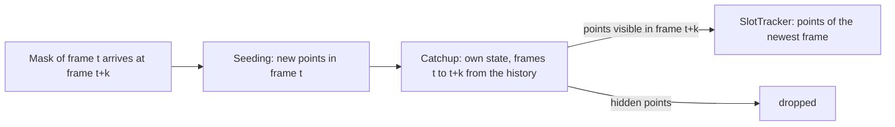

# Design

This page explains how xblick-tapnext adds points to a tracker that is already working, why it needs a
catch-up for late masks, and which rules its code follows. It also lists the tests.

## The model

TAPNext is a vision transformer (ViT) with a recurrent state per token. A *token* is a feature vector. The model
has one token for each of the 32 x 32 patches of the frame and one token per tracked point. Each of its 12 layers
first updates every token over time with a recurrent unit (an RG-LRU). Then it lets the tokens of the frame attend
to each other.

You feed the model one frame. The token of each point then gives the position and the visibility of the point in
that frame. The model waits for no later frame, which makes it an *online* tracker.

## The problem: points arrive later

DeepMind's code fixes the points when a state starts. Its documentation says that "new queries cannot be added to
an existing state". A node on a live camera gets new objects while it works, so it needs new points while it works.

## The slot trick

The node keeps one model state with `--max-tracks` slots, in `model.SlotTracker`. It uses a property that the
model learned in training. A point that is queried in a later frame is an "unknown" token until that frame.

| Slot | What the node feeds the model |
| --- | --- |
| free | a query of the future, which the model treats as "not yet queried" |
| new point | a query in the next frame |
| ended track | the state of a slot that was never used |

For the last row, the node keeps one extra slot that it never uses, the *sentinel*. When a track ends,
`SlotTracker.free` copies the RG-LRU and conv1d states of the sentinel into the slot. The slot is then free again.

A free slot never gets real coordinates.

We checked the trick against DeepMind's way with one state per group of points. The positions differ by 0.6-1.3 px
in the median. [docs/performance.md](performance.md#accuracy-against-ground-truth) has the measurement.

## Late masks and the catch-up

A result of xblick-sam3 arrives some frames after its colour frame. A point must be queried in the frame in
which it lies on the object.



The node keeps the last `--history` frames (default 60). `model.Catchup` follows the new points from their frame
to the newest frame in a state of its own. It batches the points per frame and queries each point in its frame.
The points then enter the tracker as points of the newest frame. The node drops the points that are hidden there.

A result cannot seed if the node did not track its frame. This happens when the node left the frame out, or when
the frame is older than the kept frames. The node counts such results as `seeds_too_old`.

## Objects that change their id

xblick-sam3 often gives an object a new id. In 30 s of replay it gave the objects of one desk about 200 ids.
The node therefore lets a new id adopt existing tracks. It takes the tracks of objects that are absent from a
result (`Tracks.orphans`). If such a track lies inside the mask of a new id, that id adopts it (`Tracks.adopt`).

Two more rules limit the tracks. Without a free slot, the tracks that are hidden longest end
(`Tracks.hidden_longest`). An object with more than twice `--points-per-object` tracks loses its longest hidden
ones (`Tracks.surplus`).

## Coordinates

Outside the model, a pixel centre is at an integer coordinate, as in ROS and in the matrix K of `camera_info`.
The model works in an image of 256 x 256 with pixel centres at .5 and with the order [y, x]. This holds for every
checkpoint, whatever its input resolution. `to_model` and `to_pixels` convert between the two.

## Lifting to 3D

`lifting.py` turns a pixel and its depth into a point in metres in the optical frame of the camera. It
undistorts the pixel with OpenCV. The depth image may have any size, but it must have the geometry of the colour
camera.

## Stamps only grow

The node processes only colour frames that are newer than the last tracked frame. It skips and counts older
frames. A looped playback must therefore shift its stamps, which `xblick play --loop` does.

A change of the colour camera's image size, frame id or camera model resets all tracks.

## The cloud layout is a contract

Readers depend on the layout of the cloud: the order and types of the fields, the order of the tracks by id, and
the rule that a `track_id` is never reused while the node works. Hidden tracks stay in the cloud with `visible` 0
and NaN in `x, y, z`. `tests/test_tracks.py` checks the layout. Durchblick's Rerun bridge draws `u, v` over the
image. Change the layout only together with its readers.

The node does not use Zenoh's transport compression for the clouds.

## Fail fast

The node raises an error for missing weights, a missing submodule, a bad request to the queryable and a misuse of
a slot. `queries.parse` states why a request is bad. `SlotTracker.add` refuses a slot that is in use.

## tapnet as a submodule

The node imports tapnet from the submodule `third_party/tapnet` at a fixed commit. `model._tapnext_module` puts
it on `sys.path`. The node imports only the PyTorch TAPNext. It does not install the JAX dependencies of the
tapnet package, and it copies nothing from tapnet.

## Tests

```bash
.venv/bin/python -m pytest -q
```

| File | Needs | What it checks |
| --- | --- | --- |
| `tests/test_tracks.py` | CPU | The rules of the tracks: ids, ending, drift, a slot reused since the frame of a result, the highest number per object. Seeding inside the mask and spread. Lifting against OpenCV's projection with distortion. The requests of the queryable. The published layout. |
| `tests/test_model.py` | a GPU and `weights/` | Points on a texture that moves 2 px per frame. Points added late. A reused slot. The catch-up against the working state. |

## Status and limits

- Version 0.1.0, status of 2026-11-02. We tested the node on TUM RGB-D with ground truth and end to end with
  xblick-sam3 on a replayed RGB-D sequence. We have not tested it on a robot.
- The node needs a Durchblick version that supports empty point clouds. Durchblick 0.3.25 added them.
