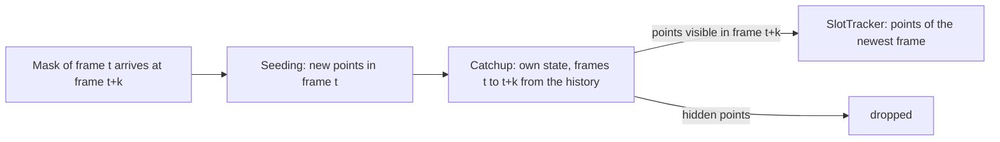

# Design

This page explains how xblick-tapnext adds points to a tracker that is already working, why it needs a
catch-up for late masks, and which rules its code follows. It also lists the tests.

## The model

TAPNext is a vision transformer (ViT) with a recurrent state per token. A *token* is a feature vector. The model
has one token for each of the 32 x 32 patches of the frame and one token per tracked point. Each of its 12 layers
first updates every token over time with a recurrent unit (an RG-LRU). Then it lets the tokens of the frame attend
to each other.

You feed the model one frame. The token of each point then gives the position and the visibility of the point in
that frame. The model waits for no later frame, which makes it an *online* tracker.

## The problem: points arrive later

DeepMind's code fixes the points when a state starts. Its documentation says that "new queries cannot be added to
an existing state". A node on a live camera gets new objects while it works, so it needs new points while it works.

## The slot trick

The node keeps one model state with `--max-tracks` slots, in `model.SlotTracker`. It uses a property that the
model learned in training. A point that is queried in a later frame is an "unknown" token until that frame.

| Slot | What the node feeds the model |
| --- | --- |
| free | a decoy: a query at a point of the image that the node never reports (`--free-slots decoys`, the default), or a query of the future, which the model treats as "not yet queried" (`--free-slots future`) |
| new point | a query in the next frame, in a slot reset to the state of a slot that was never used |
| ended track | the state of a slot that was never used, then a new decoy |

For the last two rows, the node keeps one extra slot that it never uses, the *sentinel*. When a track ends or a
point enters a slot, `SlotTracker` copies the RG-LRU and conv1d states of the sentinel into the slot.

**Why decoys.** With `--free-slots future` most of the 1024 slots are identical queries of the future, and they
degrade the real tracks. The same 64 points of TUM RGB-D, with truth from depth and the true camera poses:

| Slots | Truly visible points marked hidden (300 frames) | Same, 800 frames | Points 15 px or more off (800 frames) |
| --- | --- | --- | --- |
| 65 | 2-5 % | 2-14 % | 0-18 % |
| 1024, the free ones queries of the future | 7-35 % | 34-63 % | 6-45 % |
| 1024, the free ones decoys | 0-5 % | 0-34 % | 0-24 % |

The ranges span three and four start frames of the sequence. A decoy point is spread over the image (an R2 sequence).
A decoy that the model does not see is placed anew every 30 frames (`model.DECOY_REFRESH`). Decoys cost nothing: the
model has the same number of tokens either way.

We checked the trick against DeepMind's way with one state per group of points. The positions differ by 0.6-1.3 px
in the median. [docs/performance.md](performance.md#accuracy-against-ground-truth) has the measurement.

## Several trackers in one pass

A program that tracks several image windows, one tracker per window (one per object, each a window
around it), would run the model once per window. `model.SlotTrackers` steps such trackers in one pass: their frames
and queries are one batch, and each tracker's state is its part of the batch's state. The model keeps the batch's
frames apart (the recurrent units work per token, the attention within a frame), so each tracker gives what it gives
alone, up to float16 rounding: within 0.006 px in `tests/test_model.py`.

- Each tracker keeps its slots, queries, decoys and frame count. `add`, `free` and `SlotTracker.step` work on it as
  before.
- The RG-LRU treats a state's first frame apart from the later ones, for the whole batch. A tracker in its first
  frame therefore goes through a pass of its own, once.
- Each tracker's queries are in its own frames. The batch's state is passed at step 0, and each tracker's queries are
  shifted by its own step.
- When the next step has the same trackers in the same order, the batch's state is passed on as it is. Otherwise the
  trackers' states are concatenated, about 0.1 GB per tracker of 64 slots.

Compiled, a batch of two frames first took three times as long as two frames one after the other. torchvision's
attention turns its input to (tokens, batch, channels) before the projection, and the compiler made of that view one
small matrix product per token, reading the weights for each: 0.65 ms per layer. `model.load` therefore wraps each
attention (`_TokensFirst`): with several frames, it hands the attention its input laid out tokens first in memory, so
the view is contiguous and the projection one product. The numbers are the same; one frame passes unchanged.
`warm_up(..., batch=N)` compiles the batched shapes, which need more graphs than dynamo's limit of 8 per function
(beyond it, dynamo would run the model uncompiled), so it raises the limit to `RECOMPILE_LIMIT` (32). The time per
pass: [docs/performance.md](performance.md#several-trackers-in-one-pass).

## Late masks and the catch-up

A result of xblick-sam3 arrives some frames after its colour frame. A point must be queried in the frame in
which it lies on the object.



The node keeps the last `--history` frames (default 60). `model.Catchup` follows the new points from their frame
to the newest frame in a state of its own. It batches the points per frame and queries each point in its frame.
The points then enter the tracker as points of the newest frame. The node drops the points that are hidden there.

All points that wait at a frame catch up in one pass, from the oldest frame among them (`tracks.catchup_plan`).
The pass takes every `--catchup-stride`-th kept frame, counted back from the newest, and the frame of each waiting
result. A result whose catch-up would take more than `--max-catchup` model steps seeds nothing. The node counts it.

A catch-up step costs about as much as a step of the tracker. The model's tokens are the frame's patches and the
points, and every layer updates each token with its own recurrent state and then lets all tokens of the frame attend
to each other. Only the patch embedding (a convolution of the frame) is the same in the tracker's state and in the
catch-up's. Every later layer differs, because the catch-up's patch tokens start at the mask's frame and attend to
other point tokens. The node therefore reuses nothing between the two.

A result cannot seed if the node did not track its frame. This happens when the node left the frame out, or when
the frame is older than the kept frames. The node counts such results as `seeds_too_old`.

## Objects that change their id

xblick-sam3 often gives an object a new id. In 30 s of replay it gave the objects of one desk about 200 ids.
The node therefore lets an object adopt existing tracks. It takes the tracks that their object does not claim in
a result: tracks of objects absent from it, and tracks outside the mask of their object (`Tracks.unclaimed`). If
such a track lies inside the mask of another object of the result, that object adopts it (`Tracks.adopt`). The node
compares at the positions of the tracks in the result's own frame, which it keeps for `--history` frames, because the
camera may have moved since.

Two more rules limit the tracks. Without a free slot, the tracks that are hidden longest end
(`Tracks.hidden_longest`). An object with more than twice `--points-per-object` tracks loses its longest hidden
ones (`Tracks.surplus`).

## Coordinates

Outside the model, a pixel centre is at an integer coordinate, as in ROS and in the matrix K of `camera_info`.
The model works in an image of 256 x 256 with pixel centres at .5 and with the order [y, x]. This holds for every
checkpoint, whatever its input resolution. `to_model` and `to_pixels` convert between the two.

## Lifting to 3D

`lifting.py` turns a pixel and its depth into a point in metres in the optical frame of the camera. It
undistorts the pixel with OpenCV. The depth image may have any size, but it must have the geometry of the colour
camera.

## Stamps only grow

The node processes only colour frames that are newer than the last tracked frame. It skips and counts older
frames. A looped playback must therefore shift its stamps, which `xblick play --loop` does.

A change of the colour camera's image size, frame id or camera model resets all tracks.

## The cloud layout is a contract

Readers depend on the layout of the cloud: the order and types of the fields, the order of the tracks by id, and
the rule that a `track_id` is never reused while the node works. Hidden tracks stay in the cloud with `visible` 0
and NaN in `x, y, z`. `tests/test_tracks.py` checks the layout. Durchblick's Rerun bridge draws `u, v` over the
image. Change the layout only together with its readers.

The node does not use Zenoh's transport compression for the clouds.

## Fail fast

The node raises an error for a missing submodule, a bad request to the queryable and a misuse of
a slot. `queries.parse` states why a request is bad. `SlotTracker.add` refuses a slot that is in use.

## Weights

`weights.py` lists the checkpoints. `CHECKPOINTS` names the file in the node's cache directory, the input resolution, the URL on
DeepMind's storage, the SHA-256 and the size. The node and `tools/setup.sh` use this one list. The download itself (lock, `.part` files, checks, progress) is the core's `xblick.weights`:
`weights.STORE` is the node's `xblick.weights.Store`. Its root is the node's cache directory, `~/.cache/xblick/tapnext/`
(`XBLICK_HOME`, `XDG_CACHE_HOME`, `--weights-dir`). The checkout's `weights/` is the former place: the node does not
read weights there, and it prints the command that moves them.

At its start, before it loads the model, the node checks that the checkpoint of `--checkpoint` exists. When it
exists, the node opens no network connection and writes no file, so it starts offline. When it is missing, the node
takes the lock `~/.cache/xblick/tapnext/.download.lock`. It prints the model's terms, the file and its size, and it downloads the
file. The node writes it as `<name>.part` in `~/.cache/xblick/tapnext/` and renames it after the check. A file therefore has its
final name only when it is complete. A second node that starts at the same time waits for the lock. It then finds
the file and does not download it again.

The check compares the size and the SHA-256 of the download with those in `weights.py`. A wrong SHA-256 keeps the download as
`<name>.part`, and the error names it. Remove it, then start again. The progress is a line that updates in place on
a terminal. In a log file it is one line per tenth of the file.

A failure ends the node with one line that says what to do. Ctrl-C or SIGTERM during a download end the node at
once with the exit code 130 or 143. The node then removes the `.part` file.

`--download-only` downloads and checks the checkpoint, then ends. It also checks the SHA-256 of a checkpoint that
exists. It needs no camera, no Zenoh router and no GPU. `xblick.weights.parse_args` lifts the requirement of `--camera`
when the command line contains `--download-only`. `--no-download` ends the node when the checkpoint is missing and
names it. It is a read-only parameter like every other start option. `--download-only` is a mode of the command
line and has no parameter.

tapnet is code and no weight file. `tools/setup.sh` fetches it, and the node never clones it.

## tapnet as a submodule

The node imports tapnet from the submodule `third_party/tapnet` at a fixed commit. `model._tapnext_module` puts
it on `sys.path`. The node imports only the PyTorch TAPNext. It does not install the JAX dependencies of the
tapnet package, and it copies nothing from tapnet.

## Tests

```bash
.venv/bin/python -m pytest -q
```

| File | Needs | What it checks |
| --- | --- | --- |
| `tests/test_tracks.py` | CPU | The rules of the tracks: ids, ending, drift, a slot reused since the frame of a result, the highest number per object. Adoption of unclaimed tracks, `--refill`, the catch-up plan (`--max-catchup`, `--catchup-stride`). Seeding inside the mask and spread. Lifting against OpenCV's projection with distortion. The requests of the queryable. The published layout. |
| `tests/test_weights.py` | CPU, a local HTTP server | the checkpoints, their URLs and SHA-256, `--checkpoint 512` and a file of one's own, the node's `STORE`, `--download-only` and `--no-download`, a start that stops after its weights step without a GPU. The download itself: the core's tests |
| `tests/test_node.py` | a GPU and the checkpoint | The queryable answers while the model works. The node compiles by default, says so, and a failed compilation ends it with one line. |
| `tests/test_model.py` | a GPU and the checkpoint in the cache directory | Points on a texture that moves 2 px per frame. Points added late. A reused slot. The catch-up against the working state. A catch-up over every second frame against one over every frame. Decoys in free slots. Trackers stepped together against each alone, eager and compiled; after `warm_up(batch=3)` nothing compiles again. |

## Status and limits

- The node needs a Durchblick version that supports empty point clouds. Durchblick 0.3.25 added them.
